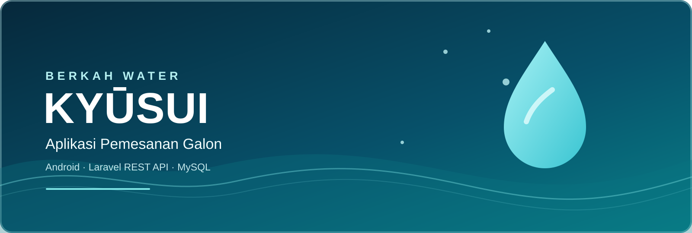
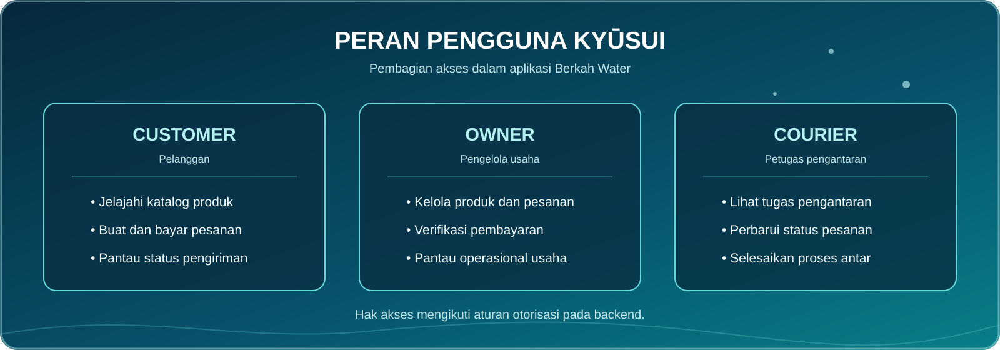
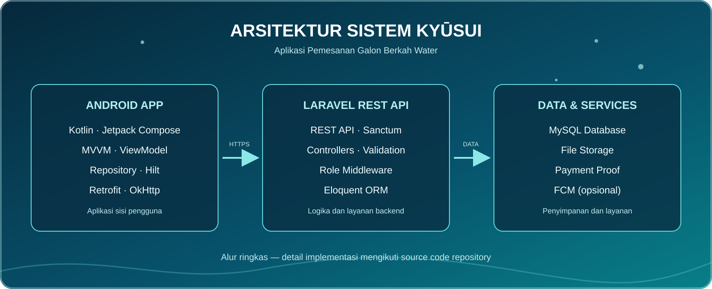

<p align="center">
  
</p>

<h1 align="center">KYŪSUI — Berkah Water</h1>

<p align="center">
  <strong>Aplikasi Pemesanan Galon Berkah Water</strong><br>
  Satu aplikasi untuk membantu proses pemesanan, pembayaran, pengelolaan pesanan, dan pengantaran galon.
</p>

<p align="center">
  <a href="https://github.com/RadinataP/aplikasi-pemesanan-galon-kyusui">Repository</a>
  &nbsp;·&nbsp;
  <a href="#fitur-utama">Fitur</a>
  &nbsp;·&nbsp;
  <a href="#arsitektur-sistem">Arsitektur</a>
  &nbsp;·&nbsp;
  <a href="#panduan-instalasi">Instalasi</a>
  &nbsp;·&nbsp;
  <a href="#api-backend">API</a>
  &nbsp;·&nbsp;
  <a href="#lisensi">Lisensi</a>
</p>

<p align="center">
  <code>Android Native</code> &nbsp;
  <code>Kotlin</code> &nbsp;
  <code>Jetpack Compose</code> &nbsp;
  <code>Laravel REST API</code> &nbsp;
  <code>MySQL</code>
</p>

---

| Informasi | Keterangan |
|:--|:--|
| **Nama aplikasi** | KYŪSUI — Berkah Water |
| **Nama repository** | `aplikasi-pemesanan-galon-kyusui` |
| **Jenis aplikasi** | Aplikasi pemesanan dan pengantaran air galon |
| **Platform utama** | Android Native |
| **Backend** | Laravel REST API |
| **Database** | MySQL |
| **Repository** | [RadinataP/aplikasi-pemesanan-galon-kyusui](https://github.com/RadinataP/aplikasi-pemesanan-galon-kyusui) |

> [!IMPORTANT]
> README ini merupakan panduan teknis untuk memahami, menyiapkan, menjalankan, menguji, dan mengembangkan project KYŪSUI. Beberapa layanan seperti Firebase, peta, dan pembayaran bergantung pada konfigurasi eksternal dan kredensial deployment.

## Daftar isi

<details open>
  <summary><strong>Jelajahi dokumentasi</strong></summary>

  **Gambaran project**
  - [Tentang aplikasi](#tentang-aplikasi)
  - [Fitur utama](#fitur-utama)
  - [Peran pengguna](#peran-pengguna)
  - [Arsitektur sistem](#arsitektur-sistem)
  - [Teknologi](#teknologi)
  - [Struktur repository](#struktur-repository)

  **Menjalankan project**
  - [Panduan instalasi](#panduan-instalasi)
  - [Persyaratan](#1-persyaratan)
  - [Instalasi backend](#3-instalasi-backend-laravel)
  - [Konfigurasi database](#4-siapkan-database-mysql)
  - [Konfigurasi Android](#6-konfigurasi-aplikasi-android)
  - [Build APK](#build-apk)

  **Referensi pengembangan**
  - [API backend](#api-backend)
  - [Integrasi eksternal](#integrasi-eksternal)
  - [Database](#database)
  - [Pengujian](#pengujian)
  - [Pemecahan masalah](#pemecahan-masalah)
  - [Keamanan](#keamanan-sebelum-deployment)
  - [Kontribusi](#pengembangan-dan-kontribusi)
  - [Lisensi](#lisensi)
</details>

---

## Tentang aplikasi

**KYŪSUI — Berkah Water** (repository **`aplikasi-pemesanan-galon-kyusui`**) adalah aplikasi pemesanan galon berbasis Android yang dikembangkan untuk mendukung proses operasional Berkah Water. Aplikasi Android berkomunikasi dengan backend Laravel melalui REST API. Backend menangani autentikasi, otorisasi berdasarkan peran, proses pesanan, pembayaran, dan penyimpanan data.

Dokumentasi ini disusun untuk tiga kebutuhan utama:

1. **Developer baru** — memahami tujuan aplikasi, komponen sistem, dan pembagian peran.
2. **Developer aktif** — menyiapkan environment, menjalankan backend dan Android, serta menjalankan pengujian.
3. **Pengelola deployment** — memahami konfigurasi yang perlu diperiksa sebelum aplikasi digunakan pada lingkungan produksi.

### Ruang lingkup dokumentasi

| Bagian | Cakupan |
|:--|:--|
| Aplikasi Android | Teknologi, konfigurasi URL API, menjalankan aplikasi, dan build APK |
| Backend | Dependency, environment, database, migration, dan server lokal |
| Integrasi | Peta/lokasi, Firebase Cloud Messaging, dan alur pembayaran QRIS |
| Pengembangan | API, pengujian, keamanan, troubleshooting, kontribusi, dan lisensi |

> [!NOTE]
> README ini mendokumentasikan source code yang tersedia di repository. Ketersediaan layanan eksternal seperti Firebase, server produksi, peta, dan konfigurasi pembayaran bergantung pada kredensial serta deployment masing-masing. Dependency yang tercantum tidak otomatis berarti layanan eksternal sudah aktif.

---

## Fitur utama

| Area | Fitur |
|---|---|
| Customer | Registrasi dan login, melihat katalog, membuat pesanan, melihat riwayat/detail pesanan, pembayaran, bukti pembayaran, status pengiriman, profil, dan notifikasi |
| Owner | Dashboard, pengelolaan produk, pesanan, kurir, informasi QRIS, pemeriksaan pembayaran, transaksi keuangan, pemasukan/pengeluaran, dan pesanan langsung |
| Courier | Dashboard kurir, melihat/claim pesanan terbuka, penugasan, perubahan status pengiriman, pembaruan lokasi, status bertugas, dan konfirmasi pembayaran tunai |
| Sistem | REST API berversi, autentikasi token, middleware role, validasi request, database relasional, penyimpanan file, dan integrasi notifikasi opsional |

Fitur yang membutuhkan layanan eksternal tidak otomatis aktif hanya karena dependency tersedia. Konfigurasikan dan uji layanan tersebut pada environment masing-masing.

### Ringkasan alur penggunaan

1. Customer memilih produk dan membuat pesanan melalui aplikasi Android.
2. Backend memvalidasi permintaan, menyimpan transaksi, dan menyediakan status pesanan.
3. Owner mengelola proses pesanan dan pemeriksaan pembayaran sesuai alur aplikasi.
4. Courier menjalankan pengantaran dan memperbarui status penugasan.
5. Customer memantau perkembangan pesanan melalui informasi dari backend.

Urutan detail, aturan perubahan status, dan hak akses mengikuti implementasi aktual pada source code backend.

---

## Peran pengguna



- **Customer** — melakukan pemesanan dan memantau proses pengantaran.
- **Owner** — mengelola produk, pesanan, pembayaran, kurir, dan informasi operasional.
- **Courier** — menjalankan penugasan dan memperbarui proses pengiriman.

Backend merupakan sumber otoritatif untuk otorisasi. Menyembunyikan menu di Android saja bukan kontrol keamanan yang memadai.

---

## Arsitektur sistem



Alur komunikasi ringkas:

1. Aplikasi Android mengirim request HTTP/JSON ke REST API.
2. Retrofit dan OkHttp menangani komunikasi jaringan.
3. Laravel memvalidasi request, token Sanctum, dan role pengguna.
4. Controller dan Eloquent menjalankan proses bisnis serta mengakses MySQL.
5. Backend mengembalikan respons JSON untuk ditampilkan oleh aplikasi Android.
6. File tertentu disimpan melalui Laravel Storage. Integrasi FCM digunakan jika sudah dikonfigurasi.

---

## Teknologi

### Android

| Komponen | Versi/teknologi pada konfigurasi project |
|---|---|
| Bahasa | Kotlin 2.0.0 |
| Android Gradle Plugin | 8.13.2 |
| Gradle Wrapper | Periksa `android/gradle/wrapper/gradle-wrapper.properties` |
| JDK | 17 |
| Compile / Target SDK | 34 / 34 |
| Minimum SDK | 24 |
| UI | Jetpack Compose, Material 3 |
| Arsitektur | MVVM, Repository Pattern |
| Dependency Injection | Hilt 2.48 |
| Networking | Retrofit 2.11.0, OkHttp 4.12.0 |
| Penyimpanan preferensi | DataStore 1.1.0 |
| Peta dan lokasi | MapLibre Android 11.8.0, Google Play Services Location 21.1.0 |
| Push notification | Firebase Cloud Messaging dependency |

Versi dependency lain dikelola melalui `android/gradle/libs.versions.toml`.

### Backend

| Komponen | Versi/teknologi pada konfigurasi project |
|---|---|
| PHP | `^8.3` |
| Laravel Framework | `^13.17` |
| Autentikasi API | Laravel Sanctum |
| ORM | Eloquent |
| Database | MySQL (sesuaikan `.env`) |
| Dependency PHP | Composer |
| Asset tooling | Node.js, npm, Vite |

Versi dependency yang terpasang mengikuti `backend/composer.lock` dan `backend/package-lock.json`.

---

## Struktur repository

```text
kyusui/
├── android/                 # Aplikasi Android native
│   ├── app/
│   │   └── src/
│   │       ├── main/
│   │       ├── test/
│   │       └── androidTest/
│   ├── gradle/
│   │   └── libs.versions.toml
│   ├── gradlew
│   └── settings.gradle.kts
│
├── backend/                 # Laravel REST API
│   ├── app/
│   │   ├── Enums/
│   │   ├── Events/
│   │   ├── Http/
│   │   ├── Models/
│   │   └── Providers/
│   ├── bootstrap/
│   ├── config/
│   ├── database/
│   │   ├── migrations/
│   │   └── seeders/
│   ├── routes/
│   ├── storage/
│   ├── composer.json
│   └── artisan
│
├── docs/
│   └── assets/              # Ilustrasi lokal README
└── README.md
```

Struktur dapat berkembang mengikuti implementasi. File dependency hasil instalasi dan hasil build tidak perlu di-commit.

---

# Panduan instalasi

## 1. Persyaratan

### Backend

- PHP 8.3 atau versi yang memenuhi constraint project.
- Composer.
- MySQL Server.
- Node.js dan npm yang kompatibel dengan Vite pada `package.json`.
- Ekstensi PHP yang dibutuhkan Laravel dan dependency Composer.
- Git.

### Android

- Android Studio yang kompatibel dengan Android Gradle Plugin 8.13.2.
- JDK 17.
- Android SDK Platform 34.
- Emulator atau perangkat Android API 24 ke atas.
- Koneksi jaringan dari perangkat/emulator ke backend.

## 2. Clone repository

Jalankan dari terminal pada direktori tempat project akan disimpan:

```bash
git clone https://github.com/RadinataP/aplikasi-pemesanan-galon-kyusui.git
cd aplikasi-pemesanan-galon-kyusui
```

> [!TIP]
> Jika repository sudah pernah di-clone, tidak perlu menjalankan `git clone` lagi. Masuk ke folder repository yang sudah ada dan sinkronkan perubahan sesuai workflow Git yang digunakan.

## 3. Instalasi backend Laravel

Masuk ke folder backend:

```bash
cd backend
```

Instal dependency:

```bash
composer install
```

Buat file environment lokal.

**Windows PowerShell:**

```powershell
Copy-Item .env.example .env
```

**Git Bash:**

```bash
cp .env.example .env
```

Buat application key:

```bash
php artisan key:generate
```

## 4. Siapkan database MySQL

Buat database kosong, misalnya:

```sql
CREATE DATABASE kyusui
CHARACTER SET utf8mb4
COLLATE utf8mb4_unicode_ci;
```

Atur koneksi pada `backend/.env`:

```dotenv
APP_NAME=KYUSUI
APP_ENV=local
APP_DEBUG=true
APP_URL=http://127.0.0.1:8000

DB_CONNECTION=mysql
DB_HOST=127.0.0.1
DB_PORT=3306
DB_DATABASE=kyusui
DB_USERNAME=root
DB_PASSWORD=
```

Sesuaikan nama database, username, dan password dengan MySQL lokal. Jangan menggunakan kredensial contoh untuk produksi.

> [!CAUTION]
> File `.env` berisi konfigurasi lokal dan dapat memuat informasi sensitif. Jangan mengunggah `.env` ke GitHub. Simpan konfigurasi rahasia hanya pada environment lokal atau secret manager/server deployment.

> [!CAUTION]
> File `.env` berisi konfigurasi lokal dan dapat memuat informasi sensitif. Jangan mengunggah `.env` ke GitHub. Simpan konfigurasi rahasia hanya pada environment lokal atau secret manager/server deployment.

Jalankan migration:

```bash
php artisan migrate
```

Jika ingin memuat data awal/demo, periksa dahulu isi `DatabaseSeeder`, lalu jalankan:

```bash
php artisan db:seed
```

**Peringatan:** seeder dapat membuat akun atau data demo. Gunakan hanya pada database development setelah memeriksa data yang akan dibuat. Jangan jalankan seeder demo pada database produksi tanpa peninjauan.

Bersihkan cache konfigurasi:

```bash
php artisan optimize:clear
```

Jika aplikasi menggunakan file pada public disk, buat symbolic link:

```bash
php artisan storage:link
```

Pastikan kebijakan akses file bukti pembayaran tetap sesuai kebutuhan keamanan. Jangan membuat bukti pembayaran privat dapat diakses publik tanpa otorisasi.

## 5. Jalankan backend

Masih dari folder `backend`:

```bash
php artisan serve --host=0.0.0.0 --port=8000
```

Endpoint pemeriksaan Laravel:

```text
http://127.0.0.1:8000/up
```

Base API lokal:

```text
http://127.0.0.1:8000/api/v1/
```

Server `artisan serve` ditujukan untuk development, bukan server produksi. Opsi `0.0.0.0` memungkinkan akses dari interface jaringan komputer; gunakan hanya pada jaringan tepercaya.

## 6. Konfigurasi aplikasi Android

Buka folder `android/` melalui Android Studio. Tunggu Gradle Sync selesai dan pastikan Gradle menggunakan JDK 17.

Aplikasi membaca URL API dari Gradle property atau `android/local.properties`. Buat file `android/local.properties` jika belum ada. File ini bersifat lokal dan tidak boleh di-commit.

### Android Emulator

Untuk emulator Android Studio yang mengakses backend di komputer host:

```properties
KYUSUI_API_BASE_URL=http://10.0.2.2:8000/api/v1/
```

`10.0.2.2` adalah alamat khusus Android Emulator standar untuk mengakses loopback komputer host. Jangan gunakan `localhost` untuk mengakses server host dari emulator karena `localhost` akan menunjuk ke perangkat/emulator itu sendiri.

### Perangkat Android fisik

Gunakan IP LAN komputer yang menjalankan backend. Contoh format:

```properties
KYUSUI_API_BASE_URL=http://192.168.1.10:8000/api/v1/
```

Ganti IP contoh dengan IP komputer yang sebenarnya. Pastikan ponsel dan komputer berada pada jaringan yang sama dan firewall mengizinkan koneksi ke port 8000.

**Ketentuan URL:**

- Gunakan URL lengkap dengan `http://` atau `https://`.
- Akhiri URL dengan `/`.
- Default debug menggunakan `http://10.0.2.2:8000/api/v1/`.
- Build release mewajibkan URL HTTPS dengan host produksi yang nyata.

### Alternatif tanpa `local.properties`

Dari folder `android` pada Windows:

```powershell
.\gradlew.bat assembleDebug -PkyusuiApiBaseUrl=http://10.0.2.2:8000/api/v1/
```

## 7. Jalankan aplikasi Android

Melalui Android Studio:

1. Buka folder `android/`.
2. Tunggu Gradle Sync.
3. Jalankan emulator atau hubungkan perangkat fisik.
4. Pilih konfigurasi `app`.
5. Tekan **Run**.

Atau melalui PowerShell dari folder `android`:

```powershell
.\gradlew.bat installDebug
```

---

## Build APK

### APK debug

```powershell
cd android
.\gradlew.bat assembleDebug
```

Lokasi APK:

```text
android/app/build/outputs/apk/debug/app-debug.apk
```

### APK release

Build release memerlukan URL backend HTTPS yang benar-benar aktif. Project menolak URL placeholder seperti `example.com`.

```powershell
.\gradlew.bat assembleRelease -PkyusuiProdApiBaseUrl=https://api.domain-anda.id/api/v1/
```

Ganti domain contoh dengan domain API produksi milik deployment. Konfigurasi signing key Android juga harus disiapkan secara terpisah dan aman. Jangan commit keystore atau password signing ke repository.

Sebelum membagikan APK release, pastikan:

- [ ] URL API mengarah ke server produksi yang benar.
- [ ] Server API menggunakan HTTPS dengan sertifikat valid.
- [ ] Signing configuration sudah benar dan keystore disimpan aman.
- [ ] Konfigurasi layanan eksternal sudah disiapkan pada environment produksi.
- [ ] Build release telah diuji pada perangkat Android target.

Sebelum membagikan APK release, pastikan:

- [ ] URL API mengarah ke server produksi yang benar.
- [ ] Server API menggunakan HTTPS dengan sertifikat valid.
- [ ] Signing configuration sudah benar dan keystore disimpan aman.
- [ ] Konfigurasi layanan eksternal sudah disiapkan pada environment produksi.
- [ ] Build release telah diuji pada perangkat Android target.

---

## API backend

Base URL lokal:

```text
http://127.0.0.1:8000/api/v1/
```

Kelompok route yang ada pada source meliputi:

| Modul | Contoh path | Peran/akses |
|---|---|---|
| Auth | `/auth/register`, `/auth/login`, `/auth/logout`, `/auth/me` | Publik atau pengguna login sesuai route |
| Dashboard | `/dashboard/customer`, `/dashboard/owner`, `/dashboard/courier` | Role terkait |
| Produk | `/products` | Pengguna sesuai middleware |
| Customer | `/customer/profile`, `/customer/orders` | Customer |
| Pembayaran customer | `/customer/payment/qris` | Customer |
| Owner | `/owner/orders`, `/owner/products` | Owner |
| Keuangan | `/owner/finance/transactions` | Owner |
| Courier | `/courier/assignments`, `/courier/open-orders` | Courier |
| Duty courier | `/courier/duty` | Courier |
| Notifikasi | `/notifications` | Pengguna terautentikasi |

Daftar di atas adalah ringkasan kelompok endpoint, bukan spesifikasi API lengkap. Method HTTP, parameter, format request/response, middleware, dan route terbaru harus diperiksa langsung dari `backend/routes/api.php`.

### Autentikasi dan otorisasi

- Endpoint publik dapat diakses tanpa token sesuai definisi route.
- Endpoint yang dilindungi `auth:sanctum` memerlukan token autentikasi yang valid.
- Endpoint khusus role harus melewati middleware otorisasi yang sesuai.
- Jangan menaruh token autentikasi di source code, README, screenshot, atau log publik.

Tampilkan seluruh route aktual:

```bash
php artisan route:list --path=api
```

Route yang dilindungi `auth:sanctum` memerlukan token valid. Endpoint tertentu juga menerapkan middleware role. Backend harus menjadi otoritas pemeriksaan akses.

---

## Integrasi eksternal

### Peta dan lokasi

Source Android menggunakan MapLibre dan Google Play Services Location. Fitur lokasi membutuhkan izin perangkat dan koneksi jaringan. Konfigurasi koordinat depot, radius layanan, serta aturan lokasi harus ditinjau oleh pemilik deployment sebelum digunakan operasional.

### Firebase Cloud Messaging

Dependency FCM tersedia pada konfigurasi Android. Notifikasi push memerlukan konfigurasi Firebase Android dan kredensial server backend yang sesuai. Jangan commit file service account, private key, atau token. Jika belum dikonfigurasi, jangan menganggap push notification sudah aktif.

### Pembayaran QRIS

Backend menyediakan alur informasi QRIS, pengiriman bukti pembayaran, serta proses pemeriksaan/verifikasi sesuai implementasi. Siapkan gambar QRIS resmi dan uji alur verifikasi. README ini tidak mengklaim integrasi payment gateway otomatis.

---

## Database

Struktur database dibuat melalui migration pada:

```text
backend/database/migrations/
```

Jalankan:

```bash
php artisan migrate:status
```

Gunakan migration sebagai acuan struktur tabel. Jangan membuat atau mengubah tabel secara manual tanpa menyelaraskannya dengan migration.

### Praktik pengelolaan database

- Gunakan database terpisah untuk development, testing, dan production.
- Pastikan file `.env` mengarah ke database yang benar sebelum menjalankan migration atau seeder.
- Periksa status migration sebelum mengubah skema.
- Buat backup sebelum menjalankan migration pada database berisi data penting.
- Jangan menghapus atau me-reset database produksi sebagai langkah troubleshooting.

---

## Pengujian

### Backend

Dari folder `backend`:

```bash
php artisan test
```

atau:

```bash
composer test
```

### Android

Dari folder `android`:

```powershell
.\gradlew.bat testDebugUnitTest
```

Tes instrumentasi membutuhkan emulator/perangkat:

```powershell
.\gradlew.bat connectedDebugAndroidTest
```

Jalankan test pada environment aktual sebelum rilis. README ini tidak menyatakan seluruh test selalu lulus.

---

## Pemecahan masalah

| Masalah | Penyebab umum | Solusi |
|---|---|---|
| Android tidak dapat mengakses API | Backend mati atau URL keliru | Jalankan backend dan periksa URL API |
| Emulator tidak terhubung ke `localhost` host | `localhost` menunjuk ke emulator | Gunakan `10.0.2.2` |
| Ponsel fisik gagal terhubung | IP LAN/firewall/jaringan | Gunakan IP komputer dan izinkan port API |
| URL Retrofit tidak valid | Base URL tidak diakhiri `/` | Tambahkan trailing slash |
| Database connection refused | MySQL mati atau `.env` salah | Periksa service MySQL dan `DB_*` |
| `APP_KEY` kosong | Key belum dibuat | Jalankan `php artisan key:generate` |
| Gradle memakai Java yang salah | JDK tidak sesuai | Atur Gradle JDK ke JDK 17 |
| Build release ditolak | URL produksi placeholder atau bukan HTTPS | Isi `kyusuiProdApiBaseUrl` dengan host HTTPS nyata |
| Notifikasi tidak masuk | Firebase belum dikonfigurasi | Periksa konfigurasi Firebase Android dan backend |

---

## Keamanan sebelum deployment

- Jangan commit `.env`, password, token, private key, atau service-account credential.
- Pastikan `APP_DEBUG=false` dan `APP_ENV=production` pada server produksi.
- Gunakan HTTPS untuk API produksi.
- Ganti kredensial dan akun demo sebelum sistem digunakan.
- Tinjau middleware role dan otorisasi setiap endpoint.
- Lindungi bukti pembayaran dan data pelanggan.
- Konfirmasi koordinat depot, radius layanan, serta konfigurasi operasional.
- Siapkan backup dan prosedur restore database.
- Jangan gunakan `php artisan serve` sebagai server produksi.
- Tinjau dependency dan jalankan test sebelum rilis.

---

## Pengembangan dan kontribusi

Kontribusi perbaikan dapat diajukan melalui fork dan pull request.

1. Fork repository.
2. Buat branch untuk fitur/perbaikan.
3. Ikuti pola arsitektur dan konvensi kode project.
4. Jalankan test yang relevan.
5. Sertakan ringkasan perubahan dan bukti pengujian pada pull request.

Jangan sertakan data pelanggan, file environment, kredensial, atau file hasil build dalam kontribusi.

---

## Lisensi

Project ini menggunakan **MIT License** untuk kode yang hak distribusinya dimiliki oleh pemegang hak cipta project. MIT mengizinkan penggunaan, penyalinan, modifikasi, penggabungan, publikasi, distribusi, sublisensi, dan penjualan salinan perangkat lunak, dengan syarat pemberitahuan hak cipta dan teks izin tetap disertakan pada salinan atau bagian substansial perangkat lunak.

Pemberian lisensi ini tidak berarti seluruh ide, konsep, dependency, library, logo, font, gambar, atau aset pihak ketiga diklaim sebagai karya orisinal pemilik repository. Komponen pihak ketiga tetap tunduk pada lisensi masing-masing.

MIT License merupakan lisensi perangkat lunak yang permisif. Penerima dapat menggunakan dan memodifikasi kode sesuai ketentuan lisensi, termasuk untuk kebutuhan komersial. Lisensi ini tidak mewajibkan karya turunan untuk menggunakan MIT License, tetapi pemberitahuan copyright dan teks izin harus tetap disertakan.

Sebelum mendistribusikan ulang project atau bagian darinya, pengguna tetap bertanggung jawab memeriksa lisensi dependency dan aset pihak ketiga yang ikut digunakan.

Jika mengadaptasi project ini, mohon pertahankan pemberitahuan hak cipta dan cantumkan atribusi kepada project asal:

**KYŪSUI — Berkah Water**  
Repository asal: https://github.com/RadinataP/aplikasi-pemesanan-galon-kyusui  
Copyright (c) 2026 RadinataP

Lihat file [`LICENSE`](LICENSE) untuk teks lisensi lengkap. Sebelum publikasi, pastikan pemegang hak cipta yang dicantumkan memang pihak yang berwenang melisensikan kode tersebut.

---

## Kredit dan apresiasi

Dikembangkan untuk mendukung operasional pemesanan dan pengantaran galon **Berkah Water**.

Jika project ini menjadi referensi atau dasar pengembangan project lain, atribusi ke repository asal sangat dihargai.

---

**KYŪSUI — Berkah Water**  
*Aplikasi Pemesanan Galon*  
Dokumentasi harus diperbarui ketika fitur, konfigurasi, endpoint, atau prosedur instalasi berubah.
